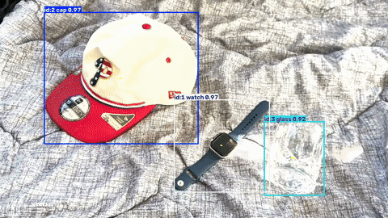
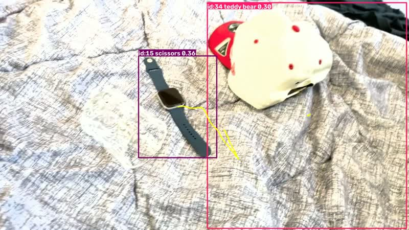
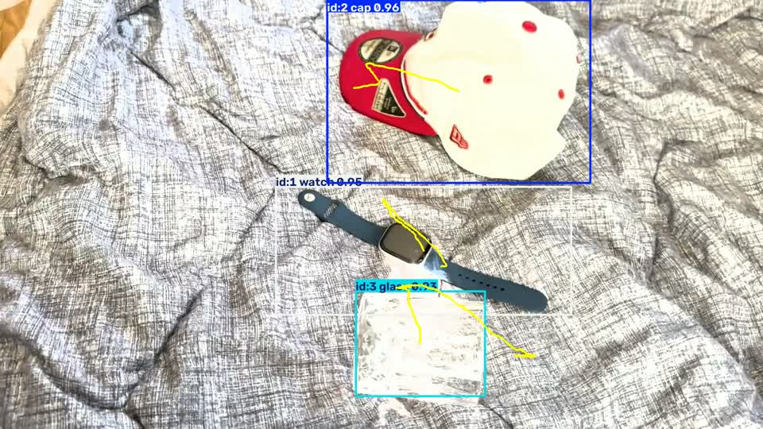
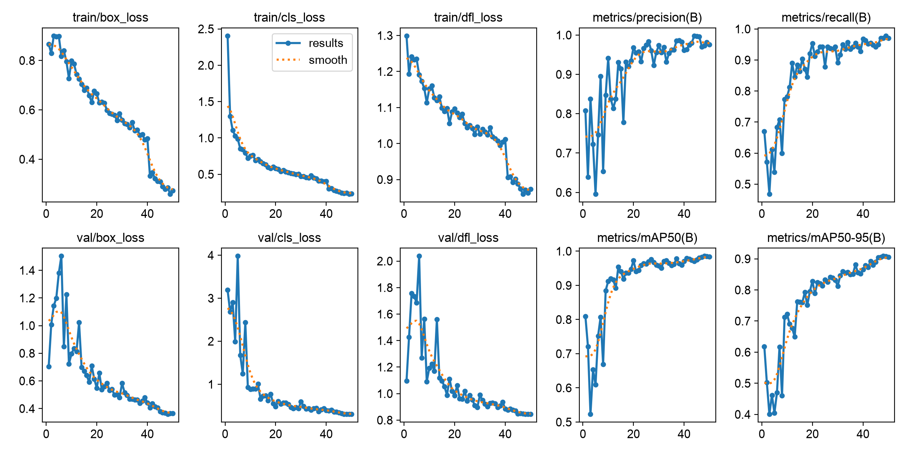
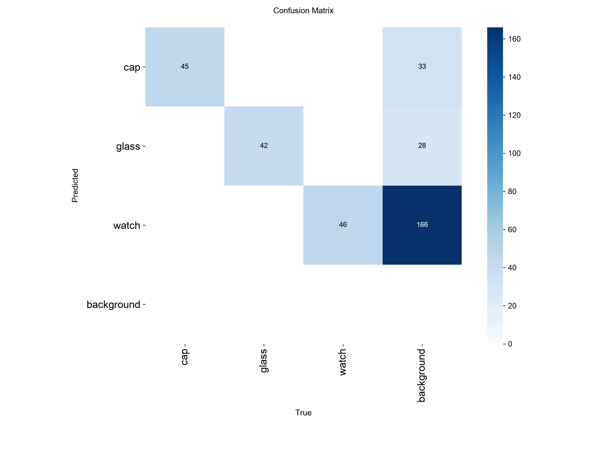
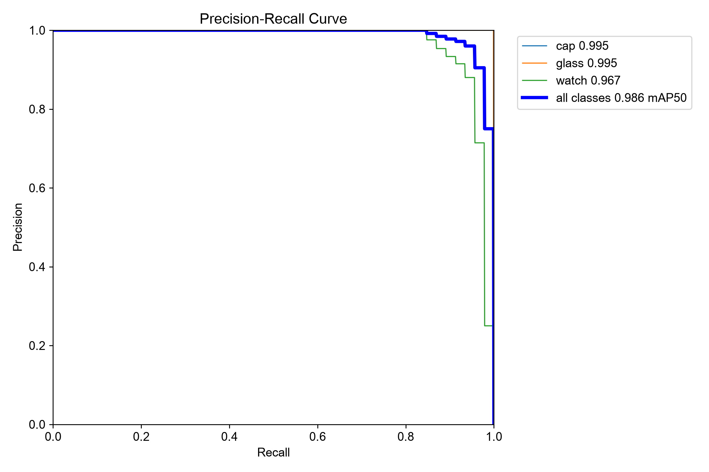

# YOLOv8 커스텀 객체 감지·추적: glass / cap / watch

직접 촬영한 이미지로 3개 부류(유리컵, 모자, 스마트워치)를 YOLOv8n에 전이학습하고, 학습된 모델로 5초 동영상에서 객체를 감지·추적했습니다.



- 추적 영상 원본: [demo/demo_tracked.mp4](demo/demo_tracked.mp4)
- 학습된 모델: [best.pt](best.pt)

## 결과 요약

| | 학습 전 (기본 yolov8n, COCO) | 학습 후 |
|---|---|---|
| glass | 데모 영상 검출 **0%** | **90%** |
| cap | `teddy bear`로 오인식 | **100%** |
| watch | `scissors`로 오인식 | **100%** |
| track ID 수 (물체 3개) | 7개 | **3개** (끝까지 유지) |

| 학습 전 | 학습 후 |
|---|---|
|  |  |

## 1. 데이터

| 단계 | 내용 |
|---|---|
| 촬영 | 부류별 단독 영상 약 40초 × 3 + 세 물체를 함께 찍은 영상 40초 (스마트폰) |
| 프레임 추출 | ffmpeg 3.5fps → glass 141, watch 150, cap 148, together 105 = **544장** |
| 라벨링 | Roboflow Auto Label(GPT-6.1 Terra)로 박스 제안 → 검토 후 승인, 7장 제외 → **537장** |
| 부류별 이미지 수 | together 사진에 3개가 모두 있어 부류별 약 250장 (기준 100장 이상) |
| 데모 영상 | together 영상의 마지막 10초는 학습에서 제외, 그중 5초를 데모로 사용 |

### 구간(block) 단위 분할
연속 프레임(0.3초 간격)을 무작위로 나누면 거의 같은 장면이 train과 valid에 동시에 들어가 검증 점수가 부풀 수 있습니다(data leakage). 그래서 영상별로 연속 10프레임(약 3초)을 한 묶음으로 만들어 묶음 단위로 나눴습니다.
→ train 395 / valid 102 / test 40장

## 2. 학습

- 모델: `yolov8n.pt` (COCO 사전학습) → 출력 3클래스로 전이학습
- 설정: 50 epochs, imgsz 640, batch 16, seed 0, YOLO 기본 증강(mosaic, HSV, flip)
- 환경: Apple M4 Pro GPU (MPS), 약 10분



- train loss와 val loss가 끝까지 함께 감소 → 뚜렷한 과적합 없음
- 40 epoch에서 loss가 떨어지는 것은 마지막 10 epoch에 mosaic 증강을 끄는 설정(`close_mosaic=10`) 때문

## 3. 성능 (test 세트, 이미지 40장 / 객체 58개)

| class | Precision | Recall | mAP50 | mAP50-95 |
|---|---|---|---|---|
| cap | 0.946 | 1.000 | 0.995 | 0.978 |
| glass | 0.989 | 1.000 | 0.995 | 0.950 |
| watch | 1.000 | 0.991 | 0.995 | 0.877 |
| **all** | **0.978** | **0.997** | **0.995** | **0.935** |

watch의 mAP50-95가 가장 낮은 것은 시계줄이 가늘고 길어 박스 끝을 정확히 맞추기 어렵기 때문으로 보입니다.

 

## 4. 실험: 무작위 분할 vs 구간 분할

| 분할 | valid mAP50 | valid mAP50-95 | 데모 검출률 cap / glass / watch |
|---|---|---|---|
| 무작위 (Roboflow 70/20/10) | 0.989 | 0.932 | 100% / 100% / 100% |
| 구간 (본 학습) | 0.986 | 0.909 | 100% / 91% / 100% |

- 무작위 분할의 검증 점수가 높았지만 차이는 작았습니다(mAP50-95 +0.023). 강한 증강 덕분에 누수 효과가 예상보다 작았던 것으로 보입니다.
- 구간 분할은 일부 각도가 통째로 학습에서 빠져, 각도에 민감한 투명 유리컵의 데모 검출률이 약간 낮았습니다.
- 정직한 평가(구간 분할)와 학습 데이터 다양성(무작위 분할) 사이의 트레이드오프를 확인했습니다. 두 방식의 valid 세트가 달라 완전히 같은 조건의 비교는 아닙니다.

## 5. 추적

- `model.track(persist=True, tracker="bytetrack.yaml")`로 프레임 간 ID 유지
- ID별 중심점 기록을 저장해 최근 90프레임(1.5초) 궤적을 노란 선으로 표시
- 결과: 300프레임 동안 ID 3개(watch=1, cap=2, glass=3)가 바뀌지 않고 유지

## 재현 방법

```bash
pip install ultralytics roboflow pyyaml lap
```

| 파일 | 용도 |
|---|---|
| [train_yolo.ipynb](train_yolo.ipynb) | Colab(T4 GPU)용 전체 과정: 다운로드 → 구간 분할 → 학습 → 평가 → 추적 |
| [train_local.py](train_local.py) | 같은 과정을 로컬(Apple GPU)에서 실행 (`dataset_rf/`에 Roboflow YOLOv8 zip 압축 해제) |
| [compare_split.py](compare_split.py) | 무작위 분할 vs 구간 분할 비교 |
| [baseline_test.py](baseline_test.py) | 학습 전 기본 모델의 인식률 측정 |
| [best.pt](best.pt) | 학습된 가중치 |

```python
from ultralytics import YOLO
YOLO("best.pt").track("demo/demo_5s.mp4", save=True, tracker="bytetrack.yaml")
```
